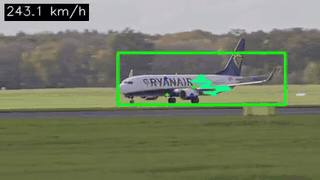
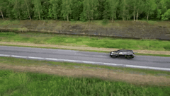
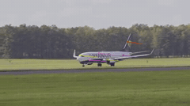

# Object Tracking in Self-Recorded Videos

Track any object in your own phone or camera video: click on it once, and get its path, its box,
its speed, line crossings and a heatmap, with CSV/JSON exports. Built on
[CoTracker3](https://github.com/facebookresearch/co-tracker) (Meta AI), OpenCV and PyTorch.

[](https://colab.research.google.com/github/AshishLahire/tracking_an_object_in_self_recorded_videos/blob/main/notebooks/colab_demo.ipynb)
[](https://huggingface.co/spaces/YOUR_HF_USERNAME/object-tracker)
[](https://github.com/AshishLahire/tracking_an_object_in_self_recorded_videos/actions/workflows/tests.yml)

This project started as a research task at IIT Mandi.

**Plane takeoff, measured from a panning video:** box tracking, camera-motion compensation, and
the plane's own length (39.5 m) as the ruler. The measured speed climbs to about 290 km/h at liftoff, in
line with a Boeing 737-800's typical takeoff speed (about 280–300 km/h).



| Bicycle | Car (side view) | Plane |
|---|---|---|
|  |  |  |
| **Tiger** | **Paragliding** | **Apple (moving camera)** |
|  |  |  |

---

## 💡 Features

| | |
|---|---|
| **Click to track** | Click one or more points on the object, or draw a box around it. Box mode tracks a grid of points, ignores background caught in the box, and moves the box with the object. |
| **Handles real videos** | Occlusions (the path breaks while the object is hidden), any resolution (large videos are downscaled), any frame rate (kept in the output). |
| **Speed and distance** | Mark something of known length once (a 1 m stick, a 4.5 m car) to get km/h and metres. Without it, results are in pixels. If the reference is the tracked object itself, the scale follows the object's size, so speed stays right as it comes closer or moves away. |
| **Line crossings** | Draw a line and get the time and direction of every crossing, e.g. counting vehicles or laps. |
| **Zones** | Draw a polygon to get entries, exits and time spent inside. |
| **Heatmap** | Shows where the object spent the most time. |
| **Shaky-camera compensation** | Removes handheld shake and panning before measuring, so speed reflects the object's motion, not the camera's. |
| **Exports** | Annotated video (H.264, plays in browsers), per-point CSV, per-frame object CSV (position, speed, box), JSON summary, heatmap PNG. |
| **Three ways to use it** | Web app, command line, or Python / notebook. |

---

## 🌍 Real-world uses

| Who | Problem | What to use |
|---|---|---|
| Sports coaches and athletes | Ball flight, sprint speed, jump arc from a phone video | Point tracking, reference length, CSV |
| Physics students and teachers | Measuring projectiles, pendulums or falling objects without lab sensors | Reference length, per-frame CSV for graphs |
| Wildlife and agriculture researchers | Animal movement and behaviour from field footage | Box tracking, heatmap, zones |
| Traffic and road-safety studies | Vehicle speed and counts at a junction | Reference length, counting lines |
| Physiotherapy and rehab | Joint or gait motion over a session | Several points, CSV export |
| Video creators | Making text or blur follow an object | Box track as per-frame CSV |

**Limits.**
- It works on recorded videos (offline), not live CCTV.
- Speed is an estimate. It is most accurate with a still camera that sees the motion side-on.
- With a fixed reference (e.g. a stick on the ground), the object must stay about as far from the camera as the reference.
- With `--reference-is-object` the object can come closer or move away, but the box must fit it tightly.
- A camera that follows the object (e.g. a drone) needs `--stabilize` and a visible background.
- Do not track people without their consent.

---

## ▶️ Quick start

```bash
pip install -r requirements.txt
```

The first run downloads the CoTracker3 model (~100 MB) via `torch.hub`, so it needs internet access.

### 1. Web app

```bash
python app.py
```

Open http://127.0.0.1:7860, then:
1. Upload a video or pick an example.
2. Choose the frame.
3. Click on the object.
4. Optionally add a reference length, line or zone.
5. Press **Track**.

### 2. Command line

```bash
# one point on the cyclist, selected on frame 70
python cli.py --video examples/bicycle.mp4 --frame 70 --point 125,50

# plane takeoff: box around the plane, its 39.5 m length as the ruler, panning camera compensated
python cli.py --video examples/plane.mp4 --box 205,100,372,152 --grid 5 --stabilize \
    --reference 210,135,345,127,39.5 --reference-is-object \
    --csv results/plane.csv --json results/plane.json --heatmap results/plane_heat.png --browser

# count crossings of a line and time spent inside a zone
python cli.py --video examples/bicycle.mp4 --frame 70 --point 125,50 \
    --line 300,60,300,200 --zone "250,100;420,100;420,240;250,240"
```

All coordinates are pixels of the original video on `--frame`. Run `python cli.py --help` for every option:
- `--zone "x,y;x,y;x,y"` adds a zone.
- `--stabilize` turns on shaky-camera compensation.
- `--max-side` and `--max-frames` limit resolution and length.
- `--mode` chooses how the model processes the video (see below).

After `pip install -e .`, the same command is available as `object-tracker ...`.

### 3. Python

```python
from tracker import track_video   # with src/ on the path, or after pip install -e .

r = track_video("examples/plane.mp4", box=(205, 100, 372, 152), box_grid=5, stabilize=True,
                reference=(210, 135, 345, 127, 39.5), reference_is_object=True,
                output_path="results/plane.mp4", csv_path="results/plane.csv")
print(r.summary()["motion"])
```

`notebooks/demo.ipynb` walks through the same steps with plots.

### GPU vs CPU (`--mode`)

- **offline** sees the whole video at once. It gives the best quality and also tracks before the selected frame, but memory grows with video length, so use it on a GPU.
- **online** works through 16-frame windows, so memory stays flat, but it tracks forward only.
- **auto** (the default) uses offline on a GPU and online on a CPU.

On a laptop CPU, expect a few minutes for a 10-second clip. On a GPU (e.g. Colab's free T4) it takes seconds.

---

## 🚀 Publish it (public link)

1. **GitHub.** This repository. The tests workflow runs on every push.
2. **Hugging Face Space (free live demo).**
   - Create a free account, and a write token at https://huggingface.co/settings/tokens.
   - Run:
     ```bash
     python deploy/prepare_space.py
     ```
     ```bash
     huggingface-cli login
     ```
     ```bash
     huggingface-cli upload YOUR_HF_USERNAME/object-tracker build/space . --repo-type=space
     ```
   - Then replace `YOUR_HF_USERNAME` above.
   - The free CPU Space processes up to 15 s per video at 512 px. Change `MAX_SECONDS` and `MAX_SIDE` in the Space settings.
3. **Colab.** The badge above opens `notebooks/colab_demo.ipynb`, which runs the app on a free GPU and prints a temporary public link.

---

## 📁 Project Structure

```
├── app.py                  # web app (Gradio)
├── cli.py                  # command line
├── src/tracker/
│   ├── pipeline.py         # track_video(): video + selection -> video, CSV, JSON, measurements
│   ├── model.py            # CoTracker3 (offline / online modes)
│   ├── selection.py        # box -> points, points -> moving box, background-point filtering
│   ├── analysis.py         # speed, distance, line crossings, zones, heatmap
│   ├── stabilize.py        # camera-motion compensation
│   ├── smoothing.py        # occlusion-aware smoothing
│   ├── draw.py             # overlays (paths, boxes, lines, zones, labels)
│   ├── video_io.py         # video read/write, CSV export, H.264 re-encode, GIFs
│   ├── metrics.py          # evaluation metrics
│   └── cli.py
├── notebooks/
│   ├── demo.ipynb          # step-by-step walkthrough
│   ├── colab_demo.ipynb    # one-click Colab version (GPU + public link)
│   └── original_experiment.ipynb
├── examples/               # sample input videos
├── results/videos/         # tracked videos from the experiments
├── docs/                   # report, screenshots, GIFs
├── deploy/                 # Hugging Face Space packaging
├── tests/                  # pytest, no model download needed
├── .github/workflows/      # CI
├── requirements.txt / requirements-dev.txt / pyproject.toml
```

---

## 🧪 Evaluation and tests

```bash
pip install -r requirements-dev.txt
```

```bash
python -m pytest
```

The tests use synthetic videos and a fake tracker, so they run in seconds without the model.

Without ground truth, the metrics (Smoothness, Continuity, Trajectory Length) describe how the track
behaves, not how accurate it is. Pass `gt_tracks` and `gt_visibility` to `tracker.evaluate_tracking`
for MSE, EPE, PCK and visibility accuracy.

## 📜 License note

CoTracker3's code and weights are released by Meta under **CC BY-NC 4.0**, which allows
non-commercial use only. Check its license before any commercial use.
